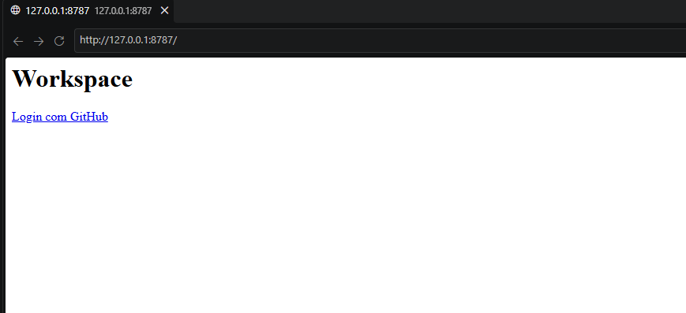
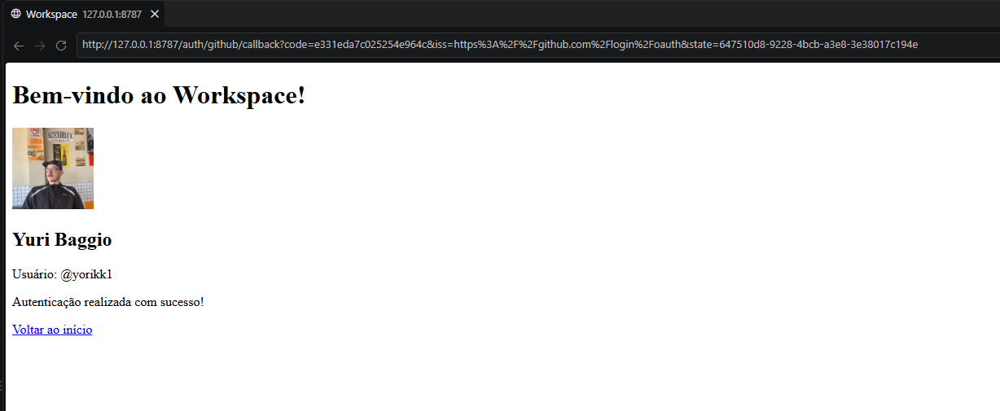

## Tecnologias utilizadas

- **TypeScript:** linguagem de programação.
- **Hono:** framework utilizado para desenvolver a aplicação e suas rotas.
- **Cloudflare Workers:** ambiente de execução da aplicação.
- **GitHub OAuth 2.0:** protocolo de autorização utilizado no login.
- **GitHub REST API:** serviço utilizado para consultar as informações do usuário autenticado.

## Funcionalidades

- Login utilizando uma conta do GitHub.
- Redirecionamento para autorização OAuth 2.0.
- Recebimento do código de autorização.
- Validação do parâmetro `state`.
- Troca do código de autorização por um token de acesso.
- Consulta das informações do usuário na API do GitHub.
- Exibição do nome, identificador e foto de perfil.

## Funcionamento da autenticação

O processo de autenticação ocorre nas seguintes etapas:

1. O usuário acessa a página inicial e seleciona **Login com GitHub**.
2. A aplicação redireciona o navegador para a página de autorização do GitHub.
3. O usuário autoriza o acesso às informações solicitadas.
4. O GitHub redireciona o usuário para a aplicação, enviando um código temporário de autorização.
5. A aplicação valida o parâmetro `state` e envia o código recebido ao GitHub para solicitar um `access_token`.
6. Com o token, a aplicação consulta o endpoint `/user` da GitHub REST API.
7. Os dados retornados são apresentados em uma página de boas-vindas.

O token de acesso é utilizado apenas pelo backend e não é exibido ao usuário.

## Como executar o projeto

### Pré-requisitos

- Node.js e npm instalados.
- Uma conta no GitHub.
- Um OAuth App cadastrado nas configurações de desenvolvedor do GitHub.

### 1. Clonar e instalar

```bash
git clone URL_DO_REPOSITORIO
cd workspace
npm install
```

### 2. Configurar o OAuth App

Acesse as configurações de desenvolvedor do GitHub e crie um OAuth App.

Configure a URL de redirecionamento:

```text
http://127.0.0.1:8787/auth/github/callback
```

### 3. Configurar variáveis de ambiente

Crie um arquivo `.dev.vars` na raiz do projeto:

```ini
GITHUB_CLIENT_ID="seu_client_id"
GITHUB_CLIENT_SECRET="seu_client_secret"
GITHUB_CALLBACK_URL="http://127.0.0.1:8787/auth/github/callback"
```

As credenciais devem ser obtidas no OAuth App cadastrado no GitHub.

### 4. Executar a aplicação

```bash
npm run dev
```

Acesse:

```text
http://127.0.0.1:8787
```

Clique em **Login com GitHub** e autorize a aplicação.

## Rotas

| Método | Rota | Descrição |
|---|---|---|
| GET | `/` | Exibe a página inicial |
| GET | `/auth/github` | Inicia a autorização OAuth |
| GET | `/auth/github/callback` | Recebe a autorização, obtém o token e consulta os dados do usuário |

## Segurança

A aplicação utiliza o fluxo **Authorization Code** do OAuth 2.0.

O parâmetro `state` é utilizado para validar a solicitação de autorização e reduzir o risco de ataques CSRF.

As credenciais do OAuth App são mantidas em variáveis de ambiente, sem exposição no frontend.

Esta versão não implementa PKCE nem sessões persistentes, pois seu objetivo é demonstrar o funcionamento básico do protocolo em um ambiente acadêmico. Esses recursos poderão ser acrescentados em versões futuras.

## Resultado esperado

Após realizar a autorização pelo GitHub, o usuário é redirecionado para uma página de boas-vindas contendo:

- Nome do usuário.
- Identificador da conta GitHub.
- Foto de perfil.
- Confirmação de autenticação realizada.



